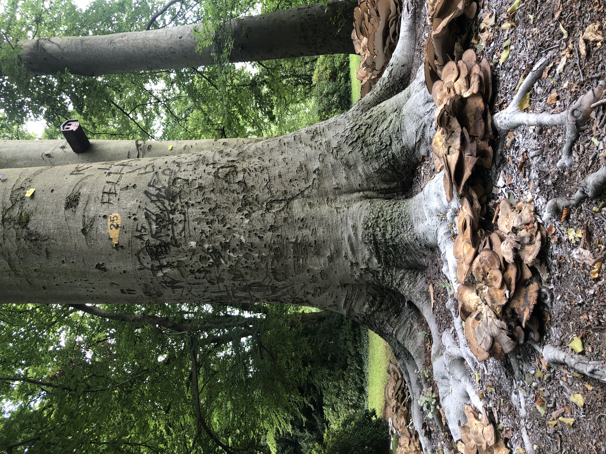

:::: {.portfolio-home}

I'm Junhui Park, currently completing an MA in Sociology – European Societies at Freie Universität Berlin.

I have over six years of experience in environmental policy and international cooperation at the Korea Environment Institute (KEI) and the United Nations Environment Programme (UNEP). My experience spans policy research, intergovernmental processes, and international project coordination.

Here, I share my empirical research notes, data analysis projects, and reading notes.

::: {.home-links}

[CV](cv.pdf)
[LinkedIn](https://www.linkedin.com/in/junhui-park-3a9761114)
[GitHub](https://github.com/joon-84)

:::

::: {.home-interests}

## Research interests

My research centres on a key question: **How can ambitious climate policy become and remain politically feasible?**

I am particularly interested in how civic engagement can strengthen democratic responsiveness in climate policymaking.

**Areas of interest:** Political sociology; climate politics; democratic and electoral responsiveness; party politics; participatory democracy; civic engagement.

## Methods and tools {.methods-heading}

- Quantitative analysis in R, including dictionary-based text analysis, regression analysis, and multilevel modelling.
- Qualitative framing analysis.

:::

[Explore my research →](research.qmd)

::::